# PrepWise AI: Personalized Interview Preparation and Career Guidance Platform

A Generative AI course project. Students upload a resume, practise DSA and soft-skill interviews, get
evidence-based feedback, and receive a personalised learning roadmap. Every unit of the syllabus is mapped to a
working feature (see [Syllabus mapping](#syllabus-mapping)).

**Design rules (hard constraints of this project)**

- **No agents.** Every flow is a fixed pipeline, prompt chain or RAG lookup. No autonomous tool-choosing loops.
- **No scraping.** Nothing is fetched from LeetCode, HackerRank, GeeksforGeeks, CodeChef, LinkedIn, Indeed, Glassdoor,
  Big Interview, Coursera, Udemy or NPTEL. Courses come only from the local, hand-curated `data/courses.json`.
- **One provider-agnostic LLM wrapper** (`backend/llm/client.py`): Gemini, OpenAI, Anthropic, Ollama, or a rule-based
  `mock` provider, selected in `.env`.
- **Code correctness comes only from sandbox test results**, never from an LLM opinion. The LLM may review style and
  logic, but its marks are capped by the test pass rate.
- **All LLM output is Pydantic-validated JSON** with up to 2 retries and a deterministic fallback.
- **Privacy:** consent gate, no raw resume text in logs, one-click full data deletion, k-anonymous admin views.

---

## Contents

1. [Quick start](#quick-start)
2. [Architecture](#architecture)
3. [Module workflows](#module-workflows)
4. [Screenshots](#screenshots)
5. [Experiments](#experiments)
6. [Testing and CI](#testing-and-ci)
7. [Deployment](#deployment)
8. [Syllabus mapping](#syllabus-mapping)
9. [Repository layout](#repository-layout)
10. [Limitations](#limitations)

---

## Quick start

Requires Python 3.11+.

```bash
git clone https://github.com/BALASUDHAN1807/PrepWise-AI.git
cd PrepWise-AI
python -m venv .venv && source .venv/bin/activate
pip install -r requirements.txt
python -m spacy download en_core_web_sm
cp .env.example .env          # then edit it
```

**Choose an LLM** in `.env`:

| `LLM_PROVIDER` | needs | notes |
|---|---|---|
| `gemini` | `GEMINI_API_KEY` | default provider |
| `openai` | `OPENAI_API_KEY` | |
| `anthropic` | `ANTHROPIC_API_KEY` | |
| `ollama` | a running Ollama server | fully local |
| `mock` | nothing | rule-based, deterministic; for tests and offline demos only |

The default model names in `.env.example` are placeholders; set `*_MODEL` to a model your account can actually call.

**Run (two terminals):**

```bash
uvicorn backend.main:app --reload --port 8000      # API  (docs at http://localhost:8000/docs)
streamlit run frontend/app.py                      # UI   (http://localhost:8501)
```

or `docker compose up --build`.

**Optional extras**

```bash
pip install -r requirements-ml.txt    # sentence-transformers, chroma, whisper, torch, transformers, peft
pip install -r requirements-dev.txt   # pytest, ruff, playwright, nbconvert
```

Without `requirements-ml.txt` the app still runs: embeddings fall back to a hashing vectoriser
(`EMBEDDING_BACKEND=hash`, not semantic) and the vector store falls back to memory. The sidebar tells you which is active.

To get an admin account, put your email in `ADMIN_EMAILS` before signing up.

---

## Architecture

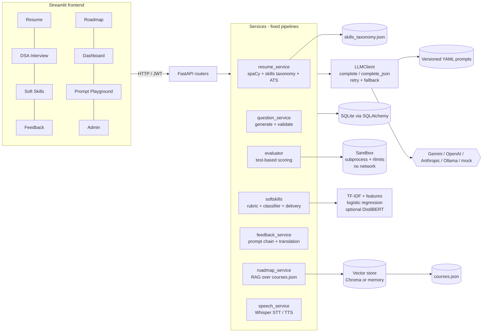

**Why this shape.** The LLM is one replaceable component behind a single wrapper. Everything that can be checked
deterministically (code correctness, skill names, course IDs, score arithmetic) is checked deterministically, and the
LLM only produces text that is then validated against a schema and against local data. See
[`docs/design_decisions.md`](docs/design_decisions.md).

---

## Module workflows

Each is a fixed sequence of steps. There is no loop in which a model decides what to do next.

**1. Resume analysis** (`/resume`)
`PDF/DOCX/text → text extraction → spaCy PhraseMatcher against skills taxonomy → LLM structured extraction (validated) →
ATS score (rule-based) → optional JD match (embedding similarity + skill overlap) → LLM bullet rewrites / cover letter
(generation, temp 0.7)`. Raw resume text is never logged.

**2. DSA interview** (`/dsa`)
`pick topic/difficulty (adaptive from the last score) → question from versioned prompt (generated, then validated, with a
fallback to data/question_bank.json) → hints (−5 each) → run visible tests in sandbox → submit against hidden tests →
score`.
Score = 60% tests, 20% logic, 10% complexity, 10% quality, minus hint penalty. The LLM-judged parts are capped by the
test pass rate (`cap_review_by_tests`), so failing code cannot score well on "logic".

**3. Soft skills** (`/soft`)
`question → typed or spoken answer (Whisper) → rubric evaluation (LLM, temp 0.2, validated) + classifier label +
delivery metrics (WPM, filler words, sentiment) → score = 70% rubric / 20% classifier / 10% delivery → follow-up question
(bounded depth)`.

**4. Feedback and mock interview** (`/sessions`, `/feedback`)
`timed session (DSA round + HR round) → per-answer evidence → strengths/weaknesses → skill gaps mapped to the taxonomy
(unknown IDs dropped) → improvement plan → optional translation (Tamil/Hindi/etc.) → PDF`.

**5. Roadmap** (`/roadmap`)
`skill gaps → retrieve candidate courses from local courses.json via embeddings (RAG) → LLM orders and explains only
the retrieved set → every course ID validated against the file`. The model cannot invent a course.

**6. Dashboard** (`/dashboard`)
Readiness = 20% resume ATS + 40% DSA + 40% soft skills (weights shown in the UI), trend, skill radar, before/after.

**7. Prompt Playground** (`/prompts`)
Pick a versioned prompt, edit variables, choose a provider/temperature, compare outputs side by side.

**8. Admin** (`/admin`)
Batch overview for a placement cell: consenting students only, salted pseudonymous IDs, groups smaller than
`ADMIN_MIN_GROUP` suppressed, CSV export disabled for small batches.

---

## Screenshots

These were captured from the running Streamlit app with `LLM_PROVIDER=mock` and a throw-away database, so the
LLM-written text is canned and rule-based. Layout, scoring, sandbox results, charts and privacy controls are real.
Re-capture with your own provider for a faithful picture.

| | |
|---|---|
| 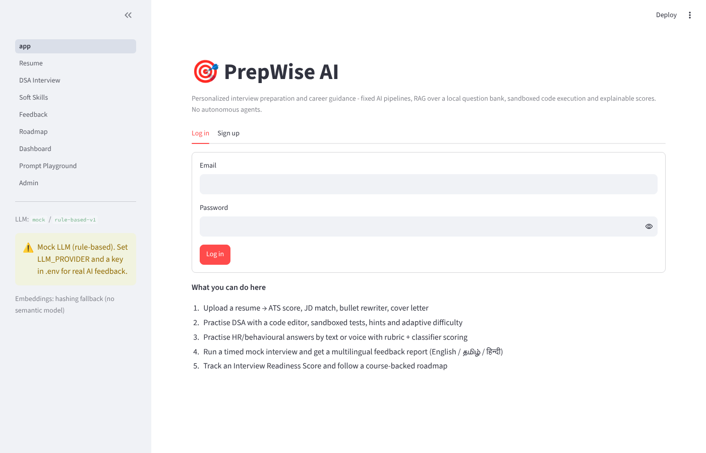 **Login / consent** | 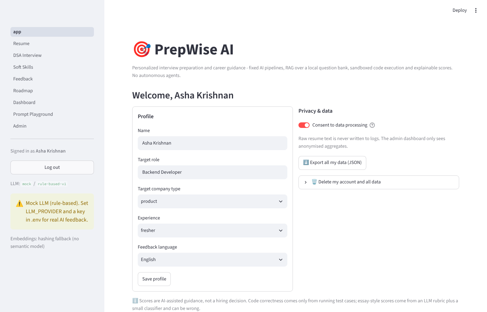 **Home** |
| 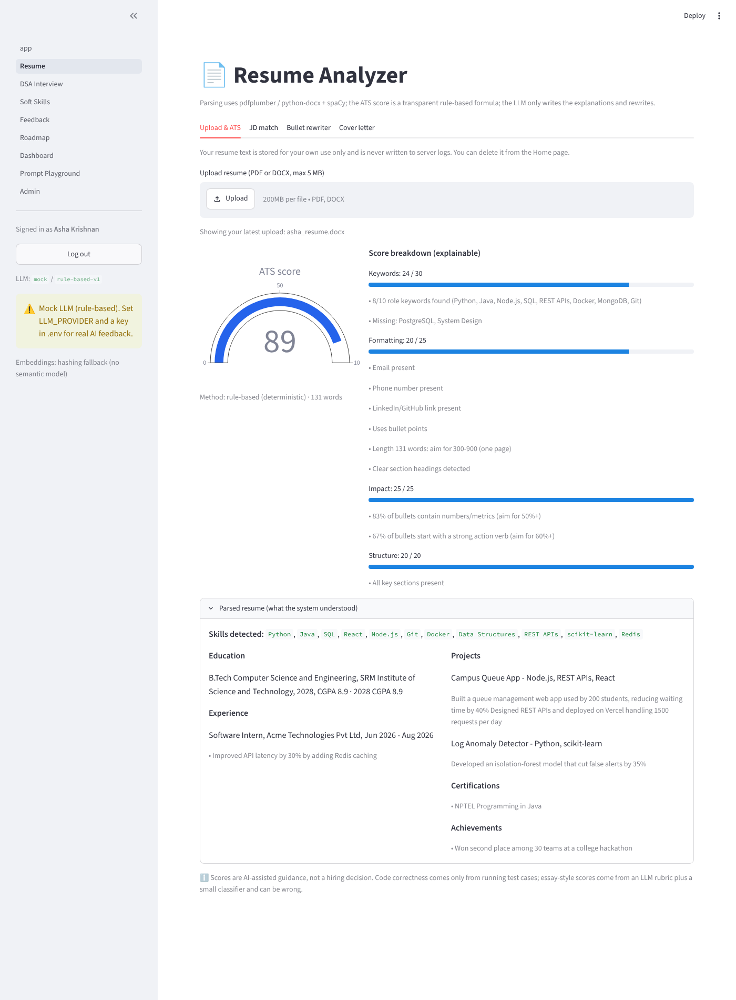 **Resume** | 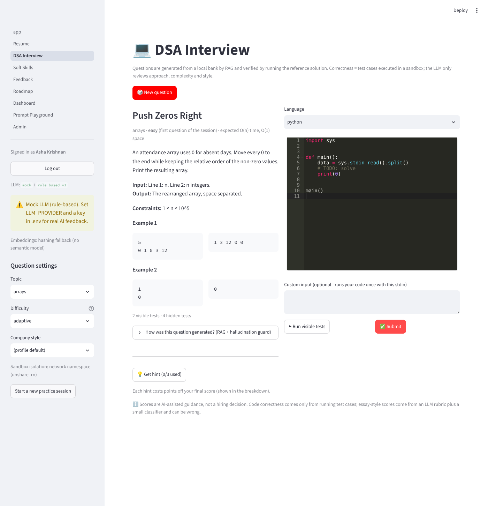 **DSA question** |
| 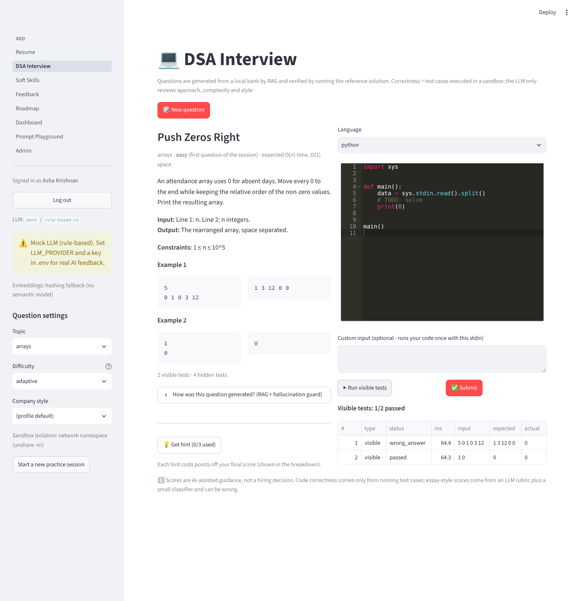 **DSA sandbox run** | 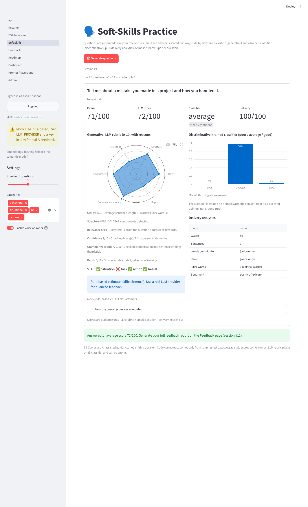 **Soft skills** |
| 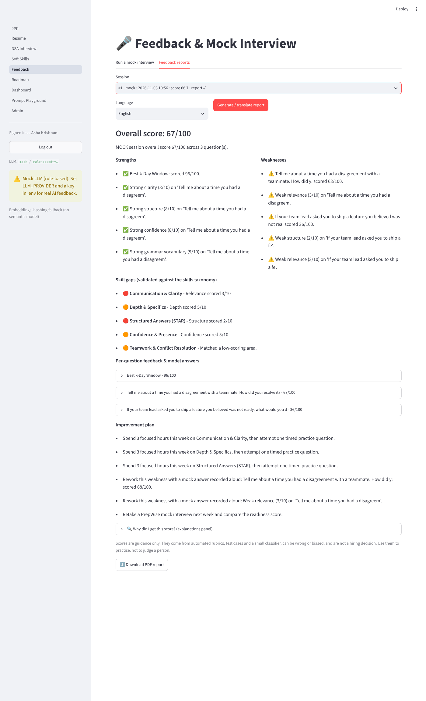 **Feedback report** | 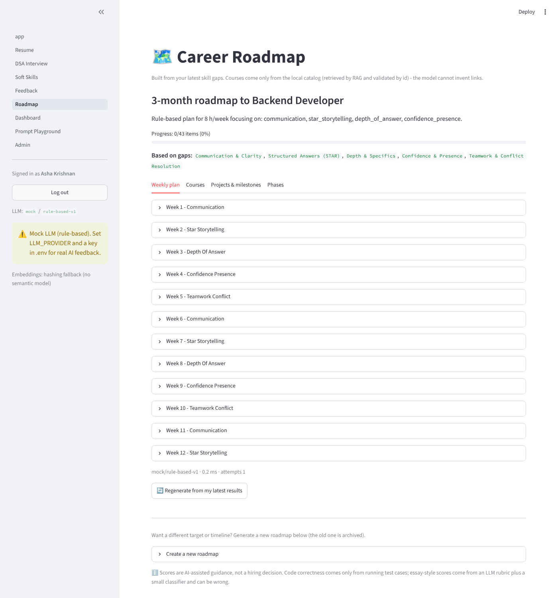 **Roadmap** |
| 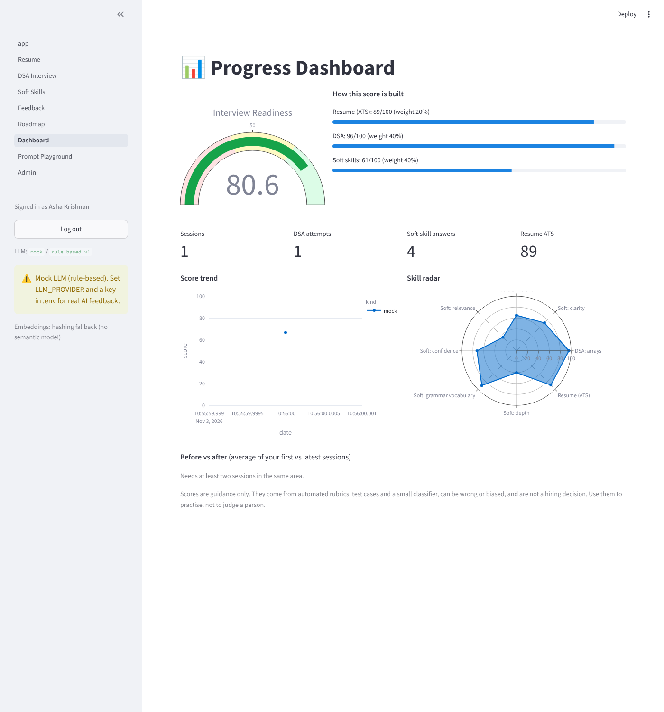 **Dashboard** | 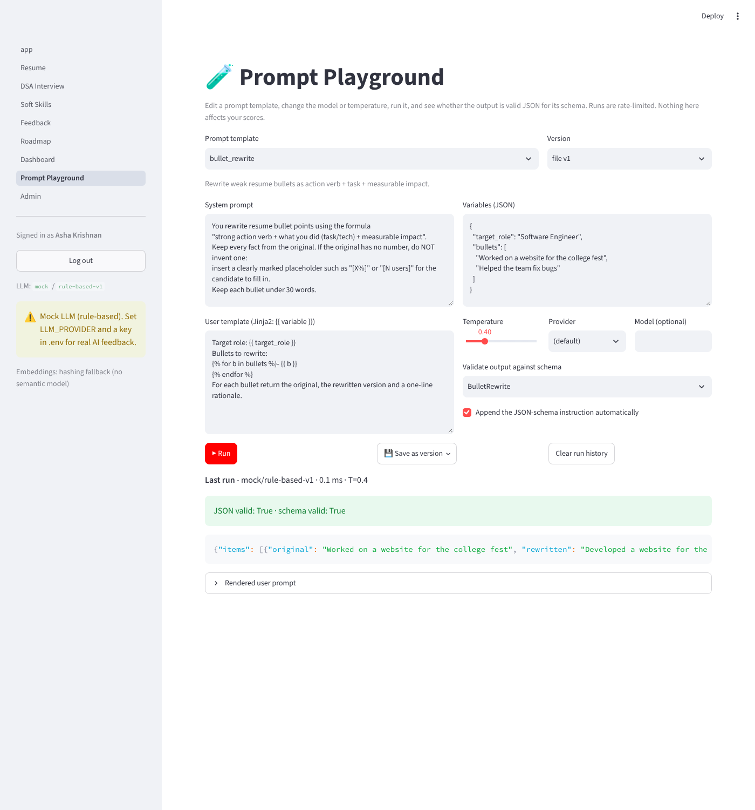 **Prompt Playground** |
| 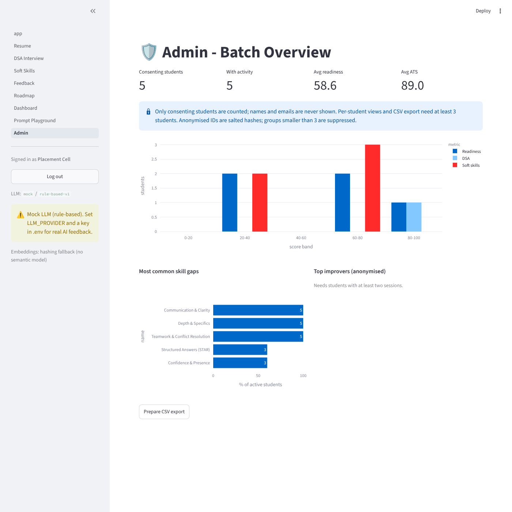 **Admin** | |

---

## Experiments

All scripts write to `reports/`. See [`reports/README.md`](reports/README.md).

| Script | What it answers | Needs |
|---|---|---|
| `scripts/train_classifier.py` | Does the answer classifier beat trivial baselines? | nothing (deterministic) |
| `scripts/prompt_comparison.py` | zero-shot vs few-shot vs role-based vs chain-of-thought vs structured output | real LLM |
| `scripts/model_comparison.py` | Same task across Gemini / OpenAI / Anthropic / Ollama | API keys |
| `scripts/eval_consistency.py` | Score variance across repeated runs | real LLM |
| `scripts/finetune_lora.py`, `notebooks/finetune_lora.ipynb` | LoRA on Flan-T5 for feedback generation vs zero-shot vs RAG (`scripts/compare_approaches.py`) | `requirements-ml.txt`, GPU helpful |
| `scripts/train_distilbert_classifier.py` | Transformer vs classical classifier | `requirements-ml.txt` |

**Committed result (real, deterministic).** `reports/classifier_eval.md`, leave-one-question-out accuracy on the
204-row labelled set:

| model | accuracy |
|---|---|
| answer length only | 0.68 |
| TF-IDF + logistic regression | 0.78 |
| TF-IDF + structural features + LR (shipped) | 0.89 |

The length-only baseline is deliberately reported because the dataset is synthetic and length is a confound; the gain
over it is the honest number. Reports from `mock` are degenerate (every strategy returns the same text) and each says so.

---

## Testing and CI

```bash
pytest -q          # unit + API-flow + Streamlit AppTest smoke tests
ruff check .
```

Tests cover the code runner, scoring, JSON validation/retry/fallback, RAG, the classifier, the end-to-end API flow, the
feedback dataset, the LoRA smoke path (tiny random model) and the frontend pages. `.github/workflows/ci.yml` runs lint,
tests and a smoke execution of both notebooks (`PREPWISE_SMOKE=1`, offline).

---

## Deployment

- `docker-compose.yml`: API + Streamlit locally.
- `deploy/hf_space/`: Docker-based Hugging Face Space (single container, mock or secrets-based provider). See
  [`docs/huggingface_spaces.md`](docs/huggingface_spaces.md).
- `render.yaml` + `deploy/render/Dockerfile`: one-click Render Blueprint (free tier, hash embeddings to fit 512 MB; untested here).
- Model card: [`docs/model_card.md`](docs/model_card.md). Dataset card: [`data/DATASET_CARD.md`](data/DATASET_CARD.md).

---

## Syllabus mapping

| Unit | Syllabus topic | Where it appears in PrepWise AI |
|---|---|---|
| **1** | Foundations of Generative AI | Generative modules: question generation, feedback, roadmap explanations, resume rewriting. Discriminative counterpart: the answer-quality classifier. Comparison in [`docs/generative_vs_discriminative.md`](docs/generative_vs_discriminative.md). Responsible AI: [`docs/responsible_ai.md`](docs/responsible_ai.md) and the "Why did I get this score?" explanations panel in the UI. |
| **2** | NLP and Large Language Models | spaCy PhraseMatcher pipeline (`nlp_service.py`); sentence-transformer embeddings for RAG (`rag_service.py`); transformer sentiment; Whisper speech-to-text; `scripts/model_comparison.py` as a multi-LLM case study. |
| **3** | Prompt Engineering | Versioned prompt library (`backend/llm/prompts/*.vN.yaml`); Prompt Playground page; `scripts/prompt_comparison.py` (zero/few-shot, role, CoT, structured); LoRA fine-tuning notebook; Streamlit as a low-code UI; compliance and debate sections in `docs/responsible_ai.md`. |
| **4** | Applications of Generative AI | GitHub repo with CI; Kaggle-style dataset card; Hugging Face model card and Spaces deployment; applications: chatbot-style interviewer, program evaluation, plans/strategy (roadmap), audio (STT/TTS); admin/enterprise dashboard; [`docs/future_trends.md`](docs/future_trends.md). |
| **5** | Industry trends and skills | [`docs/mvp_and_business.md`](docs/mvp_and_business.md): EdTech/HR-Tech landscape, competitors, Lean Canvas, MVP scope. |

---

## Repository layout

```
backend/        FastAPI app: main.py, routers/, services/, llm/ (client, prompts, mock), models/, core/
frontend/       Streamlit app.py + pages/1_Resume … 8_Admin
data/           question_bank.json (33), courses.json (28), skills_taxonomy.json (28),
                soft_skill_labeled.csv (204), feedback_sft.jsonl (204), filler_words.txt, DATASET_CARD.md
scripts/        dataset builders, training, and experiment scripts
notebooks/      finetune_lora.ipynb, classifier_training.ipynb
docs/           design, responsible AI, business, deployment, model card, screenshots
tests/          pytest suite
deploy/         Hugging Face Space files
.github/workflows/ci.yml
```

---

## Limitations

Please read these before relying on any number in this repo.

- **Datasets are synthetic and unreviewed.** `soft_skill_labeled.csv` and `feedback_sft.jsonl` were script/LLM-authored
  (12 questions, 204 answers), not human-labelled (`reviewed: false`). Classifier accuracy is on this distribution and is
  inflated by length and template effects; it will not transfer unchanged to real students.
- **Some things could not be executed in the build environment:** real MiniLM, Whisper and DistilBERT weights; live calls
  to Gemini/OpenAI/Anthropic/Ollama; real LoRA training results (only a tiny random-weight smoke run); Docker and
  Hugging Face Space builds; Tamil/Hindi translation quality. They are implemented and wired, but unverified here.
- **Default model names are unverified.** `GEMINI_MODEL` and `OPENAI_MODEL` in `.env.example` may not match what your
  account offers; set them yourself.
- **The sandbox is not a hardened multi-tenant sandbox.** It uses subprocess limits, rlimits, network isolation where
  available and a socket guard. Do not expose it to untrusted public users; use `CODE_RUNNER=judge0` or containers for that.
- **LLM-judged parts are guidance only** (logic, style, soft-skill rubric, feedback text) and can be wrong or biased.
  Scores are for practice, not hiring decisions.
- **Mock mode is not an evaluation.** Experiment reports generated with `LLM_PROVIDER=mock` are degenerate by design.
- **Course and competitor information** is a small hand-curated snapshot and general knowledge, not live data; verify
  before relying on it.
- **Small corpora:** 33 questions and 28 courses are enough to demonstrate the pipelines, not to cover a full curriculum.
- **Non-English PDFs** need a Unicode TTF (`PDF_FONT_PATH`).

## Licence and data

Educational project. Delete all of your stored data at any time from the app (Home → "Delete my account and all data").
